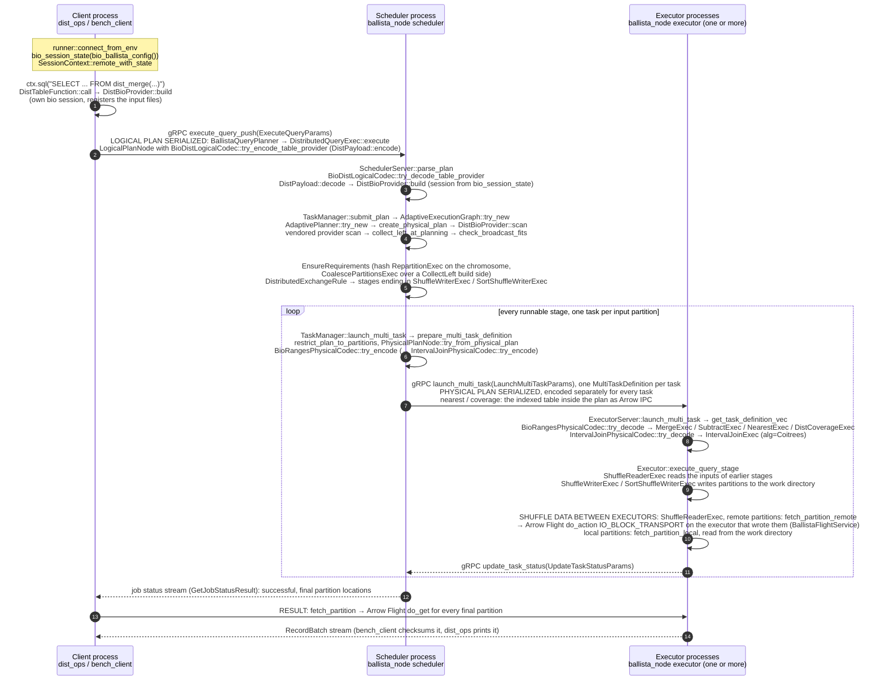
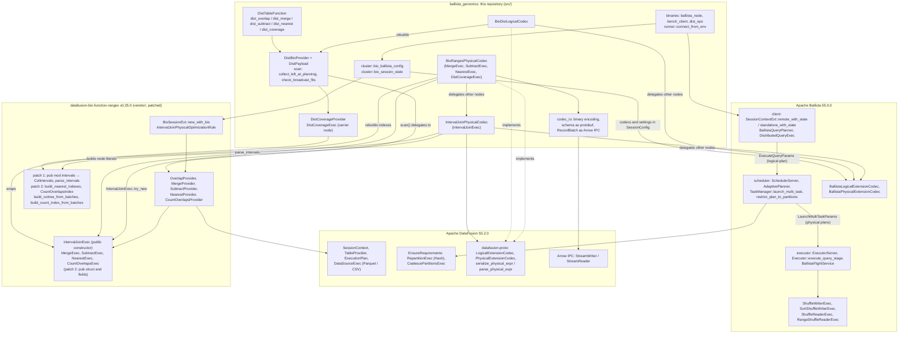

# ballista-genomics

The five genomic interval operations of [polars-bio](https://github.com/biodatageeks/polars-bio)
(overlap, nearest, coverage, merge, subtract) running distributed on
[Apache Ballista](https://github.com/apache/datafusion-ballista) 55, computed by the same
algorithm crate polars-bio is built on,
[`datafusion-bio-function-ranges`](https://github.com/biodatageeks/datafusion-bio-functions).
Ballista and DataFusion are used as released; the algorithm crate is vendored with two
visibility-only patches.

The full technical description (codecs, broadcast, per-operation execution, Ballista settings,
known limitations) is in [TECHNICAL.md](TECHNICAL.md).

## What it is

polars-bio runs its interval operations inside one process on DataFusion. Each operation is a
DataFusion `TableProvider` whose physical plan contains a custom node (`IntervalJoinExec`,
produced by the crate's optimizer rule for overlap; `MergeExec`, `SubtractExec`, `NearestExec`,
`CountOverlapsExec`, built directly in `scan()`). Ballista can run such a plan
on a cluster only if it can serialize it twice: the logical plan from the client to the scheduler,
and every stage's physical plan from the scheduler to the executors. Neither the vendored
providers nor their physical nodes have serialization, and their fields are private. This crate
adds what is missing:

- **SQL table functions** `dist_overlap`, `dist_nearest`, `dist_coverage`, `dist_merge` and
  `dist_subtract` (`src/dist_udtf.rs`), registered in the client session.
- **`DistBioProvider`** (`src/dist_provider.rs`), a `TableProvider` that wraps the vendored
  provider and keeps its constructor arguments (`DistPayload`, `src/dist_payload.rs`) next to it,
  so the provider can be rebuilt on the other side of the network. Its `scan()` delegates to the
  vendored provider, so the algorithms (COITrees and the others) are not reimplemented.
- **A logical codec**, `BioDistLogicalCodec` (`src/logical_codec.rs`): `DistBioProvider` to
  bytes and back (client to scheduler).
- **Physical codecs**, `BioRangesPhysicalCodec` (`src/bio_phys_codec.rs`; `MergeExec`,
  `SubtractExec`, `NearestExec`, `DistCoverageExec`) delegating to `IntervalJoinPhysicalCodec`
  (`src/physical_codec.rs`; `IntervalJoinExec`), which delegates to Ballista's default codec
  (scheduler to executors).
- **`DistCoverageExec`** (`src/coverage_node.rs`), a carrier node for coverage: the vendored
  `CountOverlapsExec` discards the table it indexes, so it cannot be serialized.
- **A broadcast guard** (`src/broadcast.rs`): nearest and coverage ship their indexed table inside
  the physical plan; a table too large for the gRPC message limit fails at planning time instead
  of hanging the query, provided every executor has at most two task slots (the guard counts two
  copies of the table per message; see TECHNICAL.md).
- **One session configuration for every process** (`src/cluster.rs`): codecs, the bio planner
  rules and the Ballista settings the plans depend on.

Binaries (`src/bin/`, `src/main.rs`):

| Binary | Purpose |
|---|---|
| `ballista_node` | a cluster node as a separate process: `scheduler` or `executor`, with the codecs |
| `bench_client` | runs one operation on Parquet or CSV data and prints one JSON line (rows, checksum, time); `--explain-analyze` writes the distributed plan with metrics instead |
| `dist_ops` | runs one operation on the small CSV data in `data/`, prints the result and writes it with the `EXPLAIN ANALYZE` plan to `output/` |
| `ballista_genomics` | `dist_ops overlap` kept as a separate entry point (`src/main.rs`) |
| `merge_local`, `nearest_local`, `coverage_local`, `subtract_local` | the vendored operations on plain DataFusion in one process (test references) |

`bench_client`, `dist_ops` and `ballista_genomics` share the client side:
`runner::connect_from_env()` connects to a scheduler given in `BALLISTA_SCHEDULER_URL` (a cluster
of separate processes) or, without it, starts Ballista's standalone mode (scheduler and executor
inside the client process).

## Query flow

One query on a cluster of separate processes, from the client to the result. Names are the
functions, types and messages in this repository (`src/`), in Ballista 55.0.0 and in DataFusion
55.2.0. Capitals mark where the plan is serialized (LOGICAL PLAN, PHYSICAL PLAN) and where data
crosses processes: shuffle partitions between executors (Arrow Flight `do_action` block transfer),
the final result to the client (Arrow Flight `do_get`), and the broadcast table inside the physical
plan (nearest and coverage only).



In standalone mode (no `BALLISTA_SCHEDULER_URL`) the same steps run inside the client process:
`SessionContext::standalone_with_state` starts a scheduler and an executor in-process, and the
executor pulls its tasks instead of receiving them (see the limitations in TECHNICAL.md).

## Components

What is ours, what comes from Ballista and DataFusion, and what comes from the vendored algorithm
crate (with the items the two visibility patches make public).



## Distribution strategy per operation

From `EXPLAIN ANALYZE` on a cluster of separate processes with two executors of one slot each
(`BIO_TARGET_PARTITIONS=2`, release binaries, `bench_client --explain-analyze`), on the
databio-8p pair 2-7: the first table is `exons` (438 694 intervals), the second `ex-anno`
(1 194 285 intervals); merge runs on `ex-anno` alone. The operator names are as they appear in
the plans.

| Operation | Physical node | How the work is split | Stages observed (tasks) | Crosses processes |
|---|---|---|---|---|
| overlap | `IntervalJoinExec: mode=CollectLeft, alg=Coitrees` | Every join task builds the COITrees index from the whole build side and probes it with its own partition of the other side. The build side (the join's left input, `ex-anno`) is scanned once and written to shuffle; each join task reads all of it through `CoalescePartitionsExec` ← `ShuffleReaderExec`. The probe side (`exons`) is scanned directly, one file group per task. | 2: scan of `ex-anno` → `ShuffleWriterExec` (2); join (2), `build_input_rows` = 2.39 M = 2 tasks × 1.19 M | the whole build side, to every join task (shuffle files, Flight) |
| merge | `MergeExec` | Rows hash-partitioned by chromosome (`SortShuffleWriterExec: partitioning=Hash([contig@0], 2)`); one `MergeExec` per partition, so all intervals of a chromosome meet in one task. | 2: scan → hash shuffle (2); `MergeExec` ← `ShuffleReaderExec ... Hash([contig@0], 2)` (2) | shuffle partitions by chromosome |
| subtract | `SubtractExec` (two inputs) | Both sides hash-partitioned by chromosome into the same partitions; task *i* subtracts partition *i* of the right side from partition *i* of the left. | 3: `exons` → hash shuffle (2); `ex-anno` → hash shuffle (2); `SubtractExec` ← 2 × `ShuffleReaderExec` (2) | shuffle partitions of both sides |
| nearest | `NearestExec` | Broadcast: the indexed table (`ex-anno`) travels inside the physical plan as Arrow IPC; every task rebuilds the index and processes its own partition of the queried side (`exons`). No shuffle. | 1: `NearestExec` directly over the scan of `exons` (2); payload 28 751 052 B per task | the broadcast payload inside `launch_multi_task` |
| coverage | `DistCoverageExec` over `CountOverlapsExec` | As nearest: `DistCoverageExec: coverage=true, broadcast_rows=1194285` carries the indexed table. | 1: `DistCoverageExec` directly over the scan of `exons` (2); payload 28 751 052 B per task | the broadcast payload inside `launch_multi_task` |

Every stage ends in a `ShuffleWriterExec`; the client reads the partitions of the last stage from
the executors over Arrow Flight. `bench_client` queries have no `ORDER BY`, so the last stage is
the operation's stage. `dist_ops` sorts its result, which adds one single-partition stage
(`SortPreservingMergeExec` ← `RangeShuffleReaderExec`); on its CSV data overlap stays in one stage
because each side is a single file and already satisfies `CollectLeft`. TECHNICAL.md describes
each operation, the plans and the reasons behind these strategies.

## Versions

| Component | Version |
|---|---|
| Apache Ballista (`ballista`, `ballista-core`, `ballista-scheduler`, `ballista-executor`) | 55.0.0 |
| Apache DataFusion (`datafusion`, `datafusion-proto`) | 55.2.0 (`datafusion = "=55.2.0"`) |
| `datafusion-bio-function-ranges` | v0.25.0, vendored in `vendor/` with two visibility patches |
| Rust | 1.95.0 (`rust-toolchain.toml`) |

polars-bio 0.37 is built from `datafusion-bio-function-ranges` v0.24.0 on DataFusion 53; this
crate uses v0.25.0 because Ballista 55 needs DataFusion 55. The interval algorithms are the same
in both versions: v0.25.0 ports the crate to the DataFusion 55 API (and makes the hash of the
equality keys in `IntervalJoinExec` use DataFusion's deterministic default hasher). Results are
therefore identical; small performance differences between the two DataFusion versions remain
possible. The difference disappears once polars-bio moves to DataFusion 55 (expected with
polars-bio 0.38).

## Building

Linux x86_64. Requirements: a C toolchain for linking (`build-essential` on Debian/Ubuntu) and
[rustup](https://rustup.rs) (the toolchain pinned in `rust-toolchain.toml` is installed on first
use). `protoc` is not needed: the Ballista crates ship their generated protobuf code, and no build
script in the dependency tree runs `protoc` with the features used here.

In the repository root:

```bash
cargo build --release --bins --locked   # binaries for examples and measurements
cargo build --bins --locked             # debug binaries, used by the tests
```

Every binary links the Ballista scheduler, the executor and all of DataFusion. On a machine with
little memory build with `CARGO_BUILD_JOBS=1`, so that only one crate is compiled and only one
binary linked at a time (the `dev` profile has no debug info for the same reason). With one job a
cold release build takes on the order of an hour on a 6-core laptop.

## Example

`data/` holds two small interval tables: `intervals_a.csv`/`intervals_b.csv` (one file each) and
the same rows split into two files per table in `parts_a/` and `parts_b/`, so that a scan has two
partitions. All commands run in the repository root: the plans carry the input paths, relative to
the working directory.

Standalone mode (scheduler and executor in the client process):

```bash
./target/release/dist_ops merge
```

A cluster of separate processes on one machine (`ballista_node` binds to 127.0.0.1 and announces
itself as `localhost`), each command in its own terminal. The scheduler has to listen before the
executors start: an executor connects to it once, at start-up.

```bash
./target/release/ballista_node scheduler --port 50050

mkdir -p /tmp/ballista-ex1 /tmp/ballista-ex2
./target/release/ballista_node executor --scheduler-port 50050 --port 50051 --grpc-port 50052 \
    --work-dir /tmp/ballista-ex1 --concurrent-tasks 1
./target/release/ballista_node executor --scheduler-port 50050 --port 50061 --grpc-port 50062 \
    --work-dir /tmp/ballista-ex2 --concurrent-tasks 1

BALLISTA_SCHEDULER_URL=df://localhost:50050 DIST_OUTPUT_DIR=output/cluster \
    ./target/release/dist_ops merge
```

Output of the client:

```text
Connecting to external Ballista scheduler: df://localhost:50050
Ballista cluster ready.

Time: 0.0627s
+-------+-------+-----+-------------+
| chrom | start | end | n_intervals |
+-------+-------+-----+-------------+
| chr1  | 100   | 300 | 2           |
| chr1  | 400   | 500 | 1           |
| chr2  | 50    | 150 | 1           |
| chr2  | 200   | 350 | 1           |
+-------+-------+-----+-------------+
```

`gene_A1` = [100, 200) and `gene_A2` = [150, 300) are in different files of `parts_a/`; the merged
[100, 300) appears only because the hash shuffle by chromosome brought them into one partition.
`output/cluster/dist_merge_explain.txt` holds the distributed plan with its stages
(`=========SuccessfulStage[stage_id=N, partitions=M]=========`) and operator metrics. The other
operations: `dist_ops overlap|nearest|coverage|subtract`.

`bench_client` runs one operation on any Parquet or CSV data (a file or a directory of files),
for example on the same cluster:

```bash
BALLISTA_SCHEDULER_URL=df://localhost:50050 ./target/release/bench_client \
    --op overlap --left data/parts_a --right data/parts_b --cols chrom,start,end
# {"rows": 8, "checksum": "0x152ca891baf082f9", "t_total_s": ..., ...}
```

Without `--cols` it expects the databio-8p column names (`contig,pos_start,pos_end`).
`--explain-analyze FILE` writes the plan instead of measuring; `--version-info` prints the
versions and the Ballista settings of the cluster configuration. Environment variables, read by
the client and by `ballista_node`:

| Variable | Meaning |
|---|---|
| `BALLISTA_SCHEDULER_URL` | scheduler address (`df://host:port`); unset or empty: standalone mode |
| `BIO_TARGET_PARTITIONS` | `target_partitions` of every session, an integer ≥ 2 (default 4); must be the same in all processes |
| `BALLISTA_GRPC_MAX_MESSAGE_BYTES` | gRPC message limit of the client, scheduler and executors, 16 MiB to 4 GiB − 1 (default 512 MiB); must be the same in all processes |
| `DIST_OUTPUT_DIR` | where `dist_ops` writes its result and plan (default `output/`) |
| `RUST_LOG` | log filter (`ballista_node` logs at `info` by default; `bench_client` logs only when it is set) |

## Tests

The tests are Python (pytest): they run the debug binaries and compare their results with
polars-bio 0.37, and they check the shape of the distributed plans. Requirements: the debug
binaries (`cargo build --bins --locked`) and [uv](https://docs.astral.sh/uv/) 0.12.22 (the
version is pinned in `pyproject.toml`; uv installs Python 3.12).

```bash
cargo test --lib --locked
uv sync --locked
uv run pytest -m "not real_data"
```

| Test file | Checks |
|---|---|
| `test_ballista_overlap.py`, `test_ballista_distributed_ops.py` | the `ballista_genomics` and `dist_ops` binaries (standalone mode) against polars-bio, all five operations |
| `test_ballista_distribution_evidence.py` | the plan shape of every operation (stages, hash shuffle, broadcast, `CollectLeft` with the whole build side in every task) and that the Ballista settings of the cluster configuration match TECHNICAL.md |
| `test_ballista_multiprocess.py` | a scheduler and two executors as separate processes: results, work on both executors, an executor without codecs (`--no-codecs`) cannot decode the plan |
| `test_ballista_parquet.py` | `bench_client` on a generated dataset in the databio-8p layout (directories of Parquet files, edge cases), standalone and on a cluster |
| `test_merge_correctness.py`, `test_nearest_correctness.py`, `test_coverage_subtract_correctness.py` | the `*_local` binaries (one process, plain DataFusion) against polars-bio |
| `test_oracle_sanity.py`, `test_generic_oracle.py` | the polars-bio oracles themselves |
| `test_no_workshop_refs.py` | every text file of the repository is in English |

All of them use the data in `data/` or a dataset generated by the tests. The `real_data` marker
(deselected above, as in CI) is reserved for tests on the full databio-8p datasets.

## License

Apache License 2.0 ([LICENSE](LICENSE)).
`vendor/datafusion-bio-function-ranges/` is a copy of `datafusion/bio-function-ranges` from
[biodatageeks/datafusion-bio-functions](https://github.com/biodatageeks/datafusion-bio-functions)
(tag v0.25.0) by the BiodataGeeks Team, also Apache-2.0, with local visibility patches; its
origin, licence and the patches are described in [vendor/PATCH.md](vendor/PATCH.md).
