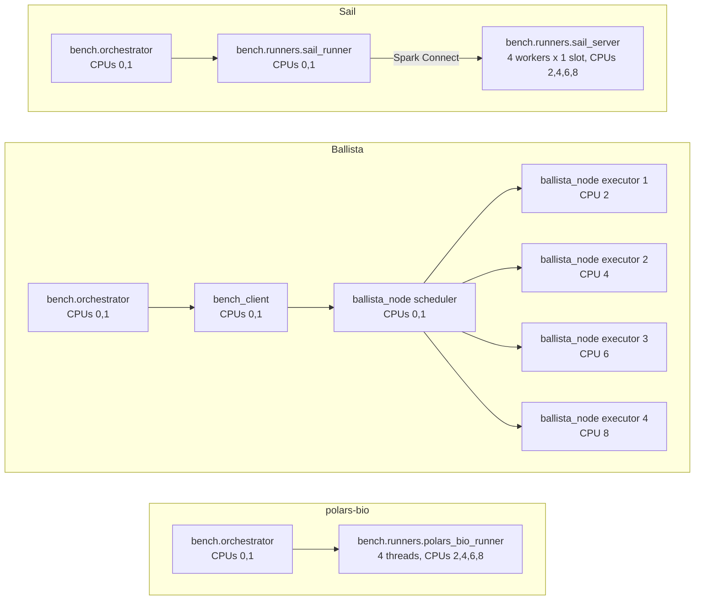
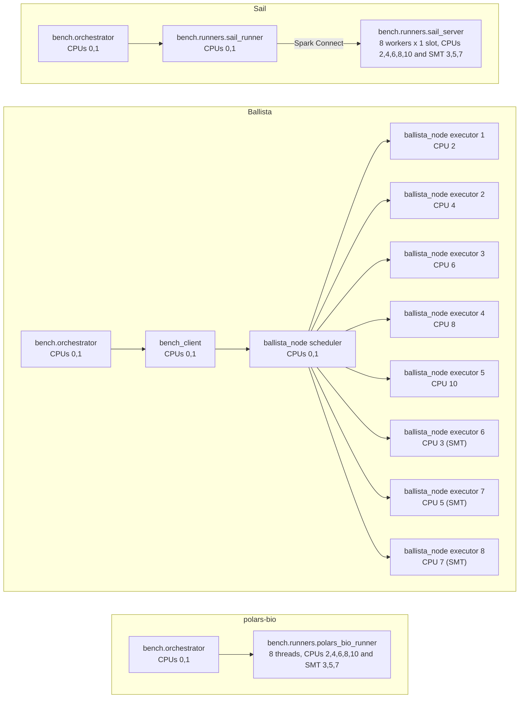

# genomics-engines-bench

A benchmark procedure for genomic interval operations (overlap, nearest, coverage, merge,
subtract) on three engines at equal CPU budgets:

- [polars-bio](https://github.com/biodatageeks/polars-bio) 0.37, one process with P threads;
- [Apache Ballista](https://datafusion.apache.org/ballista/) 55, a scheduler and P executors
  ([ballista-genomics](https://github.com/mkowalewski1282/ballista-genomics));
- [Sail](https://github.com/lakehq/sail) 0.7, one local-cluster server with P workers, driven from
  PySpark ([sail-genomics](https://github.com/mkowalewski1282/sail-genomics)).

The repository contains the `bench/` tool (orchestrator, runners, validity rules, report) and its
tests. The two engine repositories are git submodules under `engines/`; their own READMEs describe
how each engine runs a query:
[ballista-genomics/README.md](https://github.com/mkowalewski1282/ballista-genomics/blob/main/README.md)
and [sail-genomics/README.md](https://github.com/mkowalewski1282/sail-genomics/blob/main/README.md).

The tool runs on Linux only: it pins processes with `taskset` and reads the CPU topology from
`/sys/devices/system/cpu`.

The data is databio-8p, the interval datasets of the polars-bio benchmark (polars-bio-bench):
nine datasets with the identifiers 0-8 (for example 2 = `exons`, 7 = `ex-anno`), each stored as 8
Parquet files with the columns `contig`, `pos_start`, `pos_end` (0-based, half-open). A pair `a-b`
means df1 = dataset a and df2 = dataset b. `bench/data/download.py` downloads the `databio-8p.zip`
archive (about 1.2 GB) from the Google Drive location polars-bio-bench uses and checks the files
and the row counts.

## What it measures

The independent variable is the parallelism P: the number of CPUs an engine may use. At every P
all three engines get the same CPUs, and the tool measures the wall time of one operation on one
pair of datasets (`t_total_s`, from the start of the client to the checked result).

| Engine | Processes at parallelism P | Task slots | CPUs |
|---|---|---|---|
| polars-bio | 1 process, P threads (`POLARS_MAX_THREADS = P`, `target_partitions = P`) | P threads | the P CPUs of the block |
| Ballista | scheduler + client, and P executors (`ballista_node executor`) | 1 slot per executor (`--concurrent-tasks 1`) | scheduler and client on the system core; each executor pinned to one of the P CPUs |
| Sail | 1 server process (local-cluster) with P workers; the PySpark runner is a separate process | 1 slot per worker, `DEFAULT_PARALLELISM = P` | the server pinned to the P CPUs; the runner on the system core |

Two details of the equal-resources rule:

- Ballista runs with `BIO_TARGET_PARTITIONS = max(P, 2)`. The Ballista binaries reject fewer than
  2 partitions, because DataFusion does not insert hash repartitioning at one partition and the
  query would run in a single stage without distribution. At P = 1 the only executor therefore
  computes 2 partitions one after the other on its single CPU.
- The orchestrator, the Ballista scheduler and the clients (`bench_client`, `bench.runners.sail_runner`)
  run on the system core, so they do not compete with the engine's CPUs.

### CPU layout

The layout is derived from the topology and from the affinity mask of the process:

1. The first physical core (all its threads) is the system core.
2. The CPUs for P are taken from the other cores: first the first thread of every core, then the
   second threads (SMT siblings).
3. A P that needs a second thread of a core uses SMT. Such points have `smt = true` in the results,
   a trailing `*` in the P column of `summary.md` and hollow markers in the plots.
4. A P above the number of available CPUs is not an error: its rows are recorded as
   `skipped: P exceeds available CPUs` and the series continues (the 4-vCPU GitHub runners reach
   P = 2).

On the validation laptop (6 cores, 12 threads; core 0 = CPUs 0 and 1) the blocks get:

| P | CPUs | SMT |
|---|---|---|
| 1 | 2 | no |
| 2 | 2, 4 | no |
| 4 | 2, 4, 6, 8 | no |
| 8 | 2, 4, 6, 8, 10, 3, 5, 7 | yes (3, 5, 7 are siblings of 2, 4, 6) |

## Processes and CPUs at P

The diagrams show the three engines on the validation laptop. Every node is a real process; the
label is its binary or module name and the CPUs it is pinned to.

### P = 4



### P = 8 (SMT)



## Quick start

Requirements are listed [below](#requirements). The commands run from the repository root.

```bash
git clone --recursive https://github.com/mkowalewski1282/genomics-engines-bench
cd genomics-engines-bench
./setup.sh
```

`setup.sh` initialises the submodules, creates the Python environment (`uv sync --locked`), builds
the Ballista release binaries (`ballista_node`, `bench_client`; a cold build takes from about 15
minutes to over an hour and uses one build job by default, because linking needs several GB of
RAM) and downloads the databio-8p dataset into `~/bench_data` (or `$BENCH_DATA_ROOT`).

Then, with the machine idle (see [Run protocol](#run-protocol)):

```bash
# 1. Smoke series: every engine at P = 1 and 2 on the smallest pair, about 15-20 minutes.
uv run python -m bench.orchestrator bench/conf/smoke.yaml

# 2. Scaling series: 3 engines x P = 1, 2, 4, 8 x 10 scenarios, about 1.5 hours.
uv run python -m bench.orchestrator bench/conf/scaling.yaml

# 3. Report: summary.md, summary.csv and plots/ in the series directory.
uv run python -m bench.report bench/results/scaling/<timestamp>
```

`./run_series.sh` does all three steps: it prints the checklist, runs the smoke series, stops if
it failed, runs the scaling series and writes the report of the newest scaling directory.

Options of the orchestrator: `--data-root DIR` (the parent of `databio-8p`; default
`$BENCH_DATA_ROOT` or `~/bench_data`), `--results-dir DIR` (default `bench/results`) and
`--ballista-profile {release,debug}` (default `release`; a measurement uses release builds).
Every series writes to `<results-dir>/<series>/<YYYYmmdd-HHMMSS>/`: `runs.jsonl` and
`runs.parquet` (one row per run), `env.json`, `logs/`, `explain/` (Ballista `EXPLAIN ANALYZE`
outputs, where the configuration asks for them), and after `bench.report` also `summary.md`,
`summary.csv` and `plots/<op>_<pair>.png`.

Other series in `bench/conf/`: `control_noise.yaml` (the control run measured 20 times in a row,
evaluated with `uv run python -m bench.control_noise bench/results/control-noise/<timestamp>`) and
`broadcast_check.yaml` (nearest and coverage on Ballista at P = 1, 2, 4, 8: completion under the
512 MiB gRPC message limit, broadcast volume and peak memory).

## Run protocol

A series is a list of blocks, one per (engine, P). Each block follows the same protocol.

- **Reference.** Before the blocks, every scenario is run once on polars-bio with 1 partition. Its
  row count and checksum are the reference, and the result of every later run is compared with it.
  A run with a different row count or checksum is invalid.
- **Warm-up.** Warm-up rounds run before the measured repeats. They are recorded but marked as
  warm-up and excluded from the medians.
- **Control run.** Before the block's engine starts and after it stops, the same control task runs
  (10 times by default): overlap 7-0 on polars-bio with 2 threads, pinned to both threads of the
  first non-system core (or to the first two CPUs outside the system core on a machine without
  SMT), independent of P. It measures the machine, not the engine: an engine keeps the memory of
  earlier queries (Ballista several GiB), and control runs next to it were consistently slower at
  the end of a block. If the medians of the valid control runs differ by more than the tolerance,
  the block is invalid (default tolerance 10%) and is repeated once; if the second attempt drifts
  too, it stays invalid. Fewer than half valid control runs at either end also invalidates the
  block.
- **Settle time.** Every run is preceded by a pause (`settle_s`: 3 s in the shipped configurations,
  0 when a configuration leaves it out). It lets WSL2 return memory to the host. With it, the
  control-run noise was 1.8% (the control task measured 20 times in a row, 2026-10-10, validation
  laptop).
- **Swap.** A series starts only from empty swap (the preflight refuses to start otherwise). A run
  that increases `pswpout` or `pswpin` is invalid.
- **Memory guard and timeout.** A run is killed when available memory falls below 300 MiB or when
  it exceeds the time limit (`timeout_s`, 1200 s by default); it is recorded as invalid with the reason, and the engine restarts.
- **Preflight.** Before the first run the tool checks that the data of every scenario is present,
  that the CPU topology can be read and leaves P = 1 and the two control-run CPUs outside the
  system core, that swap is empty, that `taskset` is installed and `pysail` can be imported (series
  with Sail), and that the Ballista binaries exist and are newer than their sources (series with
  Ballista).

Only valid runs enter the medians of the report. The scaling series is 12 blocks x 80 runs = 960
runs plus 10 reference runs, about 1.5 hours; when every block repeats after control-run drift it
takes up to about 3 hours (the budget limit is 4 hours).

## Sail worker slots

Sail runs P workers with one task slot each. The choice was probed on Sail 0.7.3 (2026-11-16,
overlap 7-0, reference checksum `0x19f5668a8b28be3a`, 2761621 rows): the server pinned to P CPUs,
the runner on the system core, `DEFAULT_PARALLELISM = P`, `WORKER_INITIAL_COUNT = P`, a 300 s
limit. Single run per cell.

| P | slots | exit code | checksum ok | workers (log) | elapsed [s] |
|---|---|---|---|---|---|
| 1 | 1 | 0 | yes | 1 | 9.9 |
| 1 | 8 | 0 | yes | 1 | 7.0 |
| 2 | 1 | 0 | yes | 2 | 5.0 |
| 2 | 8 | 0 | yes | 2 | 4.8 |
| 4 | 1 | 0 | yes | 4 | 5.6 |
| 4 | 8 | 0 | yes | 4 | 3.9 |

In every cell the checksum was correct, the number of workers was exactly P and nothing hung, so
one slot per worker is honoured and the tool uses it. The probe exists because Sail 0.7.2
(early October 2026) sometimes started extra workers when the slot count was small, and a cap on
the worker count then made queries hang. The timings are from a single run and are not a result of
the procedure.

## Requirements

- Linux x86_64 (WSL2 works). The tool uses `taskset`, `/proc` and the sysfs CPU topology.
- [uv](https://docs.astral.sh/uv/) 0.12.x (CI uses 0.12.22): `pyproject.toml` sets
  `required-version = ">=0.12.22,<0.13"`. Python 3.12.15 (`.python-version`, installed by uv).
- [rustup](https://rustup.rs/): the Rust toolchain is pinned in the Ballista submodule
  (`rust-toolchain.toml`) and installed on the first `cargo` call.
- No `protoc`: the Ballista crates ship their generated protobuf code, and no build script in
  the dependency tree runs `protoc`.
- Network access for `setup.sh` (submodules, crates, the dataset).
- RAM: the validation series ran on a WSL2 laptop limited to 5 GB with editors and all other
  applications closed. Linking a Ballista binary needs several GB, hence one build job by default
  (`CARGO_BUILD_JOBS=N` raises it).

Before a series: close editors and background applications, leave the machine idle, and start
from empty swap (`free -h` shows `Swap` used 0B). If it is not empty: on WSL2 run `wsl --shutdown`
in Windows (and limit memory with `memory=` in `.wslconfig`); on native Linux run
`sudo swapoff -a && sudo swapon -a`.

## How to read summary.md

`bench.report` writes one section per scenario (`## <op> <pair>`, or `## merge <dataset>`) with a
table:

| variant | P | n valid | median [s] | min [s] | max [s] | speedup (self) | speedup vs polars-bio P=1 | note |
|---|---|---|---|---|---|---|---|---|
| polars_bio | 1 | 1 | 0.166 | 0.166 | 0.166 | 1.00 | 1.00 |  |
| polars_bio | 2 | 1 | 0.125 | 0.125 | 0.125 | 1.33 | 1.33 |  |
| ballista | 2 | 1 | 1.618 | 1.618 | 1.618 | 1.53 | 0.10 |  |
| sail | 2 | 1 | 0.342 | 0.342 | 0.342 | 1.09 | 0.49 |  |

The rows above are abridged from a smoke series (one run per cell, small data; the P = 1 rows of
`ballista` and `sail` are left out). They only show the shape of the table and are not results.

- `variant`: `polars_bio`, `ballista` or `sail`.
- `P`: the parallelism. A trailing `*` marks a point whose CPUs include SMT siblings.
- `n valid`: the number of valid measured runs behind the median. Invalid runs are not counted.
- `median`, `min`, `max`: `t_total_s` in seconds over the valid runs.
- `speedup (self)`: the engine's median at P = 1 divided by its median at this P.
- `speedup vs polars-bio P=1`: the single-threaded polars-bio median divided by this row's median.
  Below 1.00 means slower than one polars-bio thread.
- `note`: filled only when a point has no valid run: the most common invalid reason, for example
  `skipped: P exceeds available CPUs`, `control drift 12%` or a checksum mismatch.

`summary.csv` has the same data in machine-readable form. `plots/<op>_<pair>.png` shows the median
time against P for the three engines; hollow markers are SMT points. The raw per-run data
(phases, peak memory, `shuffle_bytes`, `broadcast_bytes`, swap counters, invalid reasons) is in
`runs.parquet`.

## Known limitations

- **DataFusion versions differ during the transition.** polars-bio 0.37 runs its interval
  algorithms on DataFusion 53 with `datafusion-bio-function-ranges` v0.24.0. Ballista runs on
  DataFusion 55.2 with v0.25.0. The crate logic is identical; the difference is the port to
  DataFusion 55. The asymmetry disappears once polars-bio ships DataFusion 55.
- **Different clients.** Ballista's client is Rust (`bench_client`), Sail's is Python (PySpark over
  Spark Connect), polars-bio runs in a Python process. Client start-up and result transfer differ,
  and `t_total_s` includes them.
- **Local mode only.** Everything runs on one machine; there is no network between nodes.
- **SMT at P = 8 on a 6-core laptop.** Three of the eight CPUs are second threads of cores that
  already run another CPU of the block. Such points are marked in the tables and plots.
- **A separate build-side stage in Ballista overlap.** Ballista overlap scans the second table of
  the pair (the join's build side) in a separate stage, and every join task reads all of it
  through a shuffle: the `CollectLeft` join needs the whole build side in every task, and
  Ballista 55's adaptive planner turns the `CoalescePartitionsExec` in front of it into a stage
  boundary (see section 6.1 of
  [ballista-genomics/TECHNICAL.md](https://github.com/mkowalewski1282/ballista-genomics/blob/main/TECHNICAL.md#61-overlap)).
- **Byte counters.** `shuffle_bytes` and `broadcast_bytes` follow Ballista 55's per-task encoding
  of the plan, so they are not comparable with counters of older Ballista versions.
- **Two partitions at Ballista P = 1.** Ballista needs at least 2 partitions, so P = 1 is "2
  partitions on one CPU", see [What it measures](#what-it-measures).

## Tests and CI

The tests run the debug Ballista binaries (`setup.sh` builds only the release ones), so build
them first; then run the tests without the real dataset:

```bash
(cd engines/ballista-genomics && cargo build --bins --locked)
uv run pytest -m "not real_data" -ra
```

The GitHub Actions workflow does the same on a 4-vCPU runner: it checks correctness, never
performance, and the tests that need a given P are skipped when the runner has fewer CPUs outside
the system core (P up to 2 there).

## Results

Results from the validation machine will be added here.

## License

Apache-2.0, see [LICENSE](LICENSE).
