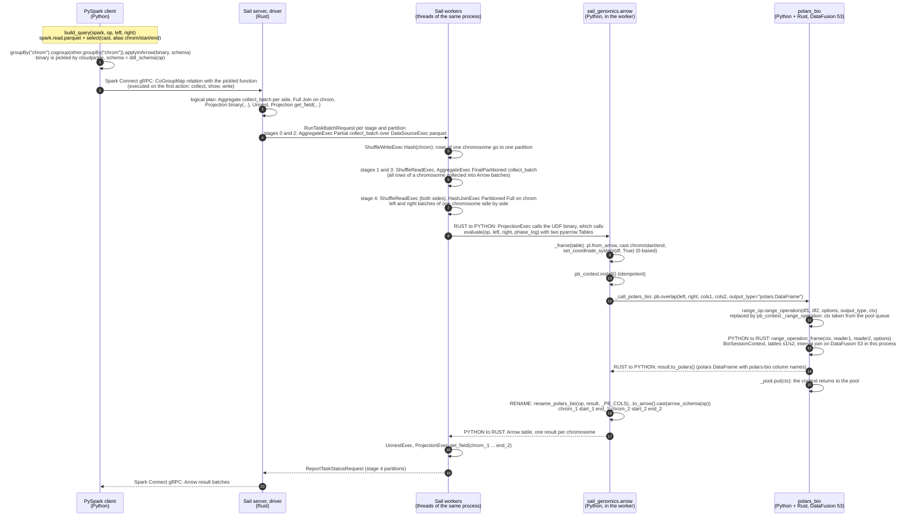
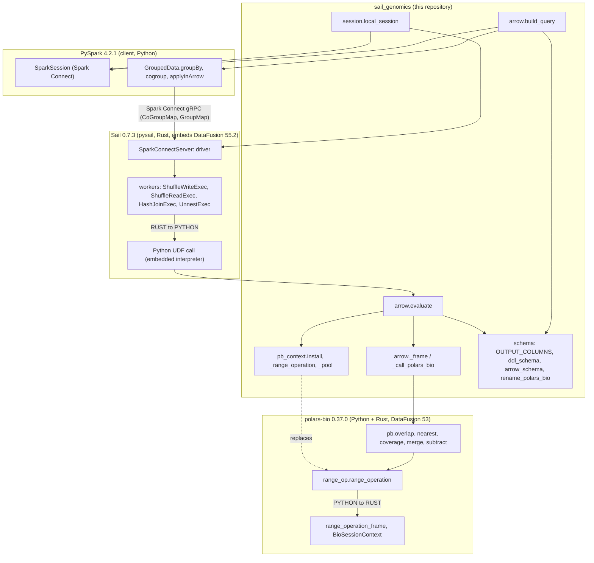

# sail-genomics

The five genomic interval operations of [polars-bio](https://github.com/biodatageeks/polars-bio)
(overlap, nearest, coverage, merge, subtract) running inside
[Sail](https://github.com/lakehq/sail) 0.7 and driven from PySpark over Spark Connect. Sail and
PySpark are used as released; polars-bio is not modified. The package is plain Python
(`sail_genomics`), not a Sail plugin.

## What it is

Sail has no interval-join operator, and polars-bio is a Python/Rust library that works on one
process. The glue between them is Spark's grouped-map API: the data is grouped by chromosome,
Sail ships every chromosome (as an Arrow table) to a Python function, and that function calls
polars-bio. Nothing is converted to Python rows: input and output stay Arrow.

```python
load(left).groupBy("chrom").cogroup(load(right).groupBy("chrom")).applyInArrow(binary, schema)
load(left).groupBy("chrom").applyInArrow(unary, schema)          # merge
```

Package layout (`src/sail_genomics/`):

| Module | Content |
|---|---|
| `arrow.py` | `build_query` (the lazy PySpark DataFrame) and `evaluate` (the function the workers run: one operation on one chromosome) |
| `pb_context.py` | `install()`: a pool of polars-bio contexts, see "Why a pool of contexts" |
| `schema.py` | the fixed output schema of each operation (`OUTPUT_COLUMNS`, `ddl_schema`) and `rename_polars_bio` |
| `session.py` | `local_session()`: a local Sail server and a Spark Connect session, for tests and scripts |

The package must be importable by name in the Sail server process (cloudpickle serializes the
function by reference to `sail_genomics.arrow`), so the server has to run in the same
environment, with the package installed or the repository as working directory.

## Query flow

One overlap query (a cogroup of two tables) from the client to the result, on a Sail server in
`local-cluster` mode. The server is a separate process here; with `local_session()` the same
server runs inside the client's Python process. Names are the functions, types and messages in
this repository (`src/sail_genomics/`), in PySpark 4.2.1, polars-bio 0.37.0 and the Sail server
(pysail 0.7.3); the plan and message names in the middle come from `df.explain(True)` and from
the server's debug log (`RUST_LOG=sail_execution=debug`) of the same query. Marked in capitals:
the points where control crosses between Python and Rust (RUST to PYTHON, PYTHON to RUST) and the
point where polars-bio column names are renamed to the output schema (RENAME).



Notes on the diagram:

- For `merge` there is one table: `groupBy("chrom").applyInArrow(unary, schema)` becomes one
  aggregate whose aggregate function is the Python function itself (no `collect_batch`, no join);
  the rest (shuffle by `chrom`, `UnnestExec`, `get_field` projection) is the same.
- The stage and message names are those of Sail 0.7.3 for this query on two workers with
  default parallelism 2. The number of stages and partitions follows the Sail configuration
  (`SAIL_CLUSTER__WORKER_INITIAL_COUNT`, `SAIL_EXECUTION__DEFAULT_PARALLELISM`) and the number of
  Parquet files; other Sail versions may cut the plan differently.
- A chromosome present only on the right side gives an empty result without calling polars-bio
  (`evaluate` returns the empty output table); present only on the left, polars-bio gets an
  empty right table and decides the semantics itself. This is why the join is a Full Join.
- The coordinate system is fixed in `_frame`: frames are tagged 0-based (the benchmark data,
  databio-8p, is 0-based half-open; it is the interval dataset of the polars-bio benchmark,
  polars-bio-bench, which [genomics-engines-bench](https://github.com/mkowalewski1282/genomics-engines-bench)
  downloads with its `bench/data/download.py`).

## Components



Two DataFusion copies are involved and they do not interact beyond Arrow data: Sail embeds
DataFusion 55.2 for its own plan, and polars-bio 0.37 brings DataFusion 53 inside its Rust
extension, running in the same process as the worker.

## Why applyInArrow, not a UDTF

The obvious alternative is a Python UDTF called with `LATERAL`. A measurement on 2026-10-11 (laptop, Ryzen 5
4600H, WSL2, Sail 0.7.2, overlap on the databio-8p dataset pair 7-0, one worker) gave 41.6 s for the UDTF
path against 2.57 s for `applyInArrow` with the pool of contexts. `LATERAL` repeats the outer row
for every output row, so memory grows quadratically with the result, and every row passes through
Python objects; PySpark UDTFs in Sail did not accept `TABLE` arguments, so a whole chromosome
could not be passed as one table. `applyInArrow` passes one Arrow table per chromosome in and
one out. (This is a historical measurement; there is no UDTF code in this repository.)

## Why a pool of contexts

polars-bio's range operations use one global `BioSessionContext` and register their inputs in it
under the fixed table names `s1` and `s2`. Sail runs the Python functions of several chromosomes
concurrently, in threads of one process, so concurrent calls collide. Checked with polars-bio
0.37.0 (2026-11-15), 8 threads x 16 calls x 5 rounds on 20k intervals: without the pool the
calls fail with `PanicException: The table s1 already exists`; with the pool 80 of 80 are
correct. A lock would avoid the collision but compute one chromosome at a time.

`pb_context.install()` replaces `polars_bio.range_op.range_operation` with a wrapper that takes
a context from a queue (`queue.SimpleQueue`) or creates one with the same options as the global
context (`OPTIONS`, plus a 0-based fallback coordinate system), passes it as the `ctx` argument
and puts it back after a successful call. After an exception the context is discarded, because a
failed call may leave `s1`/`s2` registered. The contexts are not per thread: Sail calls Python
from Rust threads and recreates the Python thread state on every call, so a `threading.local`
context becomes a per-call context.

The pool assumes eager results (`output_type="polars.DataFrame"`, as `evaluate` uses). With lazy
output polars-bio uses the context only at collect time, after it has gone back to the pool.
It depends on polars-bio internals, so the version is pinned (`polars-bio==0.37.*`) and
`tests/test_sail_pb_context.py` compares results with and without the replacement.

## Limitations

- `local-cluster` mode is one process: the "workers" are threads of the Sail server process, so
  all polars-bio contexts, the shuffle and the Python interpreter share one address space.
  Real multi-process execution needs Sail on Kubernetes; it is not covered here.
- Sail starts the workers for every Spark Connect session (`SAIL_MODE=local-cluster`,
  `SAIL_CLUSTER__WORKER_INITIAL_COUNT`); `local_session()` uses whatever mode the environment
  selects, and the Sail default (local mode) runs without workers.
- applyInArrow needs the output schema up front, so each operation has a fixed output schema
  (`schema.OUTPUT_COLUMNS`): `chrom_1, start_1, end_1, chrom_2, start_2, end_2` for overlap,
  the same plus `distance` for nearest, `chrom, start, end, coverage` for coverage,
  `chrom, start, end, n_intervals` for merge, `chrom, start, end` for subtract. Columns are
  `string` for names starting with `chrom` and `long` otherwise.
- The input column names are a parameter of `build_query` (`cols`, default `contig, pos_start,
  pos_end`); they are cast to `chrom` (string), `start`, `end` (long) before grouping.
- The input is Parquet (a file or a directory). Both sides of a binary operation are read through
  Spark, there is no lazy or file-path mode for polars-bio.
- The 0-based coordinate system is fixed (`_frame`).

## Usage

Install (Linux, Python 3.12, [uv](https://docs.astral.sh/uv/) 0.12.x; CI uses 0.12.22):

```bash
uv sync --locked
```

A runnable example: two small Parquet tables, overlap and merge through a local Sail server.

```python
import os
os.environ.setdefault("MPLBACKEND", "Agg")  # polars-bio imports matplotlib

import tempfile
import pyarrow as pa
import pyarrow.parquet as pq
from sail_genomics import build_query, local_session

root = tempfile.mkdtemp()
pq.write_table(pa.table({"contig": ["chr1", "chr1", "chr1", "chr2"],
                         "pos_start": [100, 150, 400, 10],
                         "pos_end": [200, 300, 500, 50]}), f"{root}/a.parquet")
pq.write_table(pa.table({"contig": ["chr1", "chr1", "chr2"],
                         "pos_start": [180, 450, 20],
                         "pos_end": [260, 460, 30]}), f"{root}/b.parquet")

with local_session() as spark:
    overlap = build_query(spark, "overlap", f"{root}/a.parquet", f"{root}/b.parquet")
    overlap.orderBy(*overlap.columns).show()
    merge = build_query(spark, "merge", f"{root}/a.parquet")
    merge.orderBy(*merge.columns).show()
```

Expected output (row order fixed by `orderBy`):

```
+-------+-------+-----+-------+-------+-----+
|chrom_1|start_1|end_1|chrom_2|start_2|end_2|
+-------+-------+-----+-------+-------+-----+
|   chr1|    100|  200|   chr1|    180|  260|
|   chr1|    150|  300|   chr1|    180|  260|
|   chr1|    400|  500|   chr1|    450|  460|
|   chr2|     10|   50|   chr2|     20|   30|
+-------+-------+-----+-------+-------+-----+

+-----+-----+---+-----------+
|chrom|start|end|n_intervals|
+-----+-----+---+-----------+
| chr1|  100|300|          2|
| chr1|  400|500|          1|
| chr2|   10| 50|          1|
+-----+-----+---+-----------+
```

`build_query(spark, op, left, right=None, cols=("contig", "pos_start", "pos_end"), *,
phase_log=None)` returns a lazy DataFrame; `op` is one of `overlap`, `nearest`, `coverage`,
`merge`, `subtract` (`merge` takes one table, the others two). With `phase_log` set to a file
path, every polars-bio call appends a JSON line `{"pb_s": ...}` with its duration, and
`sail_genomics.arrow.read_phases(path)` sums them.

To run against a separate Sail server with workers, start it with the package importable and
connect with `SparkSession.builder.remote("sc://127.0.0.1:<port>")`:

```bash
SAIL_MODE=local-cluster SAIL_CLUSTER__WORKER_INITIAL_COUNT=2 \
SAIL_CLUSTER__WORKER_TASK_SLOTS=1 SAIL_EXECUTION__DEFAULT_PARALLELISM=2 \
uv run python -c "
from pysail.spark import SparkConnectServer
s = SparkConnectServer('127.0.0.1', 50051); s.start(background=True)
import time
while s.running: time.sleep(1)"
```

With Sail 0.7.3, a default parallelism equal to the worker count gave exactly that many workers
in a probe (P = 1, 2, 4 workers with 1 or 8 slots each, one run per cell). With one slot per
worker, a default parallelism above the worker count makes Sail add workers on its own.

## Tests

```bash
uv sync --locked
uv run pytest
```

The tests start a local Sail server, run every operation on a small Parquet fixture and compare
the result with polars-bio called directly (the oracle); `tests/test_sail_pb_context.py` covers the pool of contexts.

## License

Apache-2.0, see [LICENSE](LICENSE).
